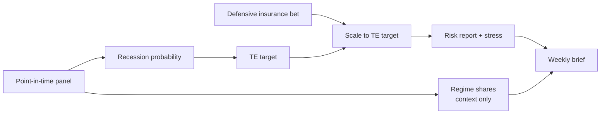

# Package 2: forecast-light

Top-down engine for the SIG sector portfolio, **package 2: forecast-light**.

It makes one forecast, the probability of a US recession in the next 12 months, and uses it to
decide how much defensive insurance to hold. Every other sector stays at its S&P 500 weight.
The idea follows Bridgewater's All Weather logic (prepare rather than predict) applied as a
benchmark-relative overlay, with Grinold-Kahn tracking-error budgeting as the discipline.



## What a weekly run produces

- Regime shares (what share of reasonable specifications put us in each growth x inflation regime)
- Recession probability, calibrated out of sample, and scenario priors for the analysts
- Proposed weights: benchmark + defensive insurance, sized between 1.0% and 3.5% tracking error
- Risk report (tracking error and its Euler split, VaR/CVaR) and historical stress replays

## Quick start

```bash
make install                 # editable install
export FRED_API_KEY=...      # free key from fred.stlouisfed.org
make data                    # point-in-time caches (Bloomberg exports: see data/bloomberg/MANIFEST.md)
make weekly                  # reports/brief_<date>.html
make test
```

## Layout

```text
config.yaml                  every parameter: mandate, series registry, regime, recession, insurance, risk
src/sigtd/
  data/                      M1  point-in-time Panel (FRED, ALFRED vintages, prices, Bloomberg)
  features/                  M1  transforms, z-scores without look-ahead
  regime/                    M2  quadrant classifier + specification grid (context only)
  probability/               M5  recession logit, calibration, scenario priors
  portfolio/                 M6  covariance, insurance bet, risk-budget sizing
  risk/                      M7  tracking error, VaR, stress replays, walk-forward backtest
  report/                    M8  dashboard + weekly brief
  pipeline.py                the weekly run, end to end (read this first)
tests/                       acceptance tests; stubs are expected failures until written
docs/                        design note, methodology, pre-registrations
research_log.md              every test, failures included
```

## Status

| Module | Phase | Tag | Status |
| --- | --- | --- | --- |
| M1 data + dashboard | Nov 23 - Dec 6 | v0.1 | stub |
| M2 regime (context) | Dec 19 - 23 | v0.2 | stub |
| M5 recession probability | Jan 4 - 10 | v0.5 | stub |
| M6 risk-budget construction | Jan 11 - 17 | v0.6 | stub |
| M7 risk + backtest | Jan 18 - 24 | v0.7 | stub |
| M8 brief + release | Jan 25 - 31 | v1.0 | stub |

Infrastructure (config, CLI, pipeline wiring, fixtures, tests) is written. Model logic raises
`NotImplementedError` with a pointer to its phase; the matching tests are marked as expected
failures and turn into passes as each module is written.

## What this package deliberately does not do

No sector return forecasts, no optimizer, no analyst views in the weights. It is the most robust
and easiest to defend of the options, and it has the least to say about individual sectors.
The quantamental package (`../quantamental`) contains this engine as its fallback mode.
