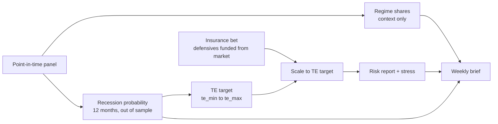

# Design note: forecast-light engine

## The question it answers

How much defensive insurance should the portfolio carry this week, given the risk of recession,
and what does that cost in tracking error?

## Data flow

## Interfaces

Every model: `run(panel, as_of, cfg)`. Only `panel.as_of`, `panel.returns_through` and
`panel.benchmark` may be used. Weights are a `pd.Series` indexed by sector key, summing to 1.

| Module | Consumes | Produces |
| --- | --- | --- |
| data.panel | config registry, caches | `Panel` |
| regime.spec_grid | Panel | regime shares (sum to 1) |
| probability.recession | Panel | p(recession in 12m) |
| portfolio.risk_budget | Panel, p | weights |
| risk.* | weights, Panel | TE, contributions, VaR, replays |
| report.brief | everything above | HTML |

## What it deliberately does not do

No sector return forecasts, no optimizer, no analyst views in the weights. Analysts' work feeds the
narrative and the scenario matrix; the weights move only with recession risk.
