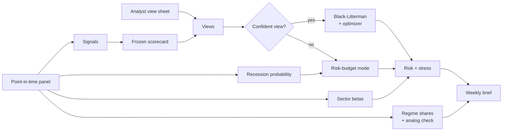

# Package 3: quantamental

Top-down engine for the SIG sector portfolio, **package 3: quantamental hybrid**.

Tested signals and the analysts' written views become 11 sector weights through Black-Litterman
and a constrained optimizer, sized by a tracking-error target. When no view is confident, the
engine falls back to the forecast-light mode (benchmark + insurance sized by recession risk) and
says so at the top of the brief.



## Lineage

| Piece | Established framework |
| --- | --- |
| Regime quadrants | Merrill Lynch Investment Clock; Fidelity business-cycle approach |
| Analog regimes (cross-check) | Mulliner, Harvey et al., "Regimes" (JPM 2026) |
| Recession probability | Estrella-Mishkin yield-curve model; NY Fed |
| Momentum signal | Moskowitz-Grinblatt (1999) industry momentum |
| Point-in-time macro scores | Macrosynergy / JPMaQS quantamental indicators |
| Construction | Black-Litterman (1992) with Idzorek confidences |
| Risk discipline | Grinold-Kahn tracking-error budgeting |
| Fallback | All Weather logic: prepare rather than predict |

## What a weekly run produces

Everything in the forecast-light brief, plus: sector betas and factor shocks, the signal scorecard
(with power thresholds), the views table, the engine mode, and how far each view moved the weights.

## Quick start

```bash
make install
export FRED_API_KEY=...
make data                    # plus Bloomberg exports: see data/bloomberg/MANIFEST*.md
make research                # frozen signal scorecard -> outputs/scorecard.csv
cp views/view_sheet_template.csv views/view_sheet.csv   # analysts fill this in
make weekly
make test
```

## Layout

```text
config.yaml                  every parameter, including pre-registered signals and BL settings
src/sigtd/
  data/                      M1  point-in-time Panel
  features/                  M1  transforms
  regime/                    M2  classifier, spec grid, conditional returns, analog regimes
  sensitivities/             M3  sector x factor betas
  signals/                   M4  signal library, walk-forward evaluation, power checks
  probability/               M5  recession logit, calibration, scenario priors
  portfolio/                 M6  covariance, equilibrium, views, Black-Litterman, optimizer,
                                 attribution, mode switch, risk-budget fallback
  risk/                      M7  tracking error, VaR, stress + factor shocks, backtest
  report/                    M8  dashboard + weekly brief
  pipeline.py                the weekly run, end to end (read this first)
views/                       analyst view sheets
tests/                       acceptance tests; stubs are expected failures until written
docs/                        design note, methodology, pre-registrations
research_log.md              every test, failures included
```

## Status

| Module | Phase | Tag | Status |
| --- | --- | --- | --- |
| M1 data + dashboard | Nov 23 - Dec 6 | v0.1 | stub |
| M2 regime + analogs | Dec 19 - 23 | v0.2 | stub |
| M3 sensitivities | Dec 19 - 23 | v0.3 | stub |
| M4 signals | Dec 28 - Jan 3 | v0.4 | stub |
| M5 recession probability | Jan 4 - 10 | v0.5 | stub |
| M6 construction (BL + fallback) | Jan 11 - 17 | v0.6 | stub |
| M7 risk + backtest | Jan 18 - 24 | v0.7 | stub |
| M8 brief + release | Jan 25 - 31 | v1.0 | stub |

Infrastructure (config, CLI, pipeline wiring, fixtures, tests) is written. Model logic raises
`NotImplementedError` with a pointer to its phase; the matching tests are marked as expected
failures and turn into passes as each module is written.

## The null-result rule

If no view reaches confidence 3, the engine runs in risk-budget mode. Weak evidence becomes a
position (benchmark plus insurance), never silence.
