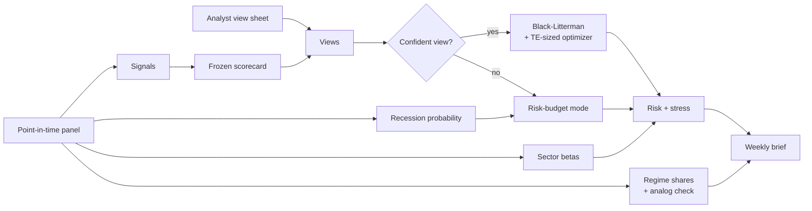

# Package 3: quantamental (runnable reference implementation)

> **This branch (`demo/quantamental-runnable`) is a working reference version** written to show what
> the package does and how it changes the weekly workflow. It is deliberately simple in places (see
> "Shortcuts" below). The stubbed version on `main` is still the one to build yourself; use this
> branch as a spec and a test oracle, not as code to copy.

Tested signals and the analysts' written views become 11 sector weights through Black-Litterman,
sized by a tracking-error target. When no view is confident, the engine falls back to the
forecast-light mode (benchmark + insurance sized by recession risk) and says so at the top of the brief.



## Run it (no API key needed)

```bash
make install
make import-fall-cache       # copies the FRED/Yahoo CSV cache from SIG_FALL_26 (data to Oct 2026)
make demo                    # research + backtest + dashboard + both brief modes, ~2 minutes
open reports/brief_*.html
make test                    # 36 tests, including end-to-end runs on the cached data
```

Sample outputs from 2026-11-20 are committed in [`examples/`](examples): the brief with the
fictional demo views (Black-Litterman mode), the same week with no views (risk-budget mode), and the
macro dashboard. Download an HTML file and open it in a browser.

Day to day: `make weekly` uses `views/view_sheet.csv` if it exists, otherwise the fictional demo
sheet (and says so in red). `make weekly-fallback` runs with no views. `make data` re-downloads
everything with a FRED key.

## What the reference run found (data through October 2026)

| Piece | Result | What it means for the team |
| --- | --- | --- |
| Regime | 9 of 9 specifications: Reflation (September 2026) | A unanimous call; say "all specs agree" rather than "we think" |
| Recession model | 6% now; out of sample since 1995: AUC 0.84, Brier skill -0.04 | Ranks risk well, calibrates poorly (the 2022-24 false alarm). Trust direction, not level |
| Signals | 4 tested, 0 pass; momentum IC 0.017 (t 0.7) vs a 0.045 power threshold; 2 skipped (need Bloomberg) | No signal view enters the weights. Analyst views carry the portfolio |
| Backtest 2006-2026 | Signals + BL: -0.50%/yr (IR -0.28, t -1.3); risk-budget: -0.35%/yr (t -1.3) | Both added value until about 2017, then lost it in the tech-led market; neither result is significant |
| Demo views (fictional) | 5 views, confidence 2-4, ex-ante TE 2.4% | Each view moves its own sector; tech goes to -5 pp because overweights are funded pro rata and tech is 38% of the benchmark |
| No views | Defensive insurance +2.1 pp each in XLP, XLU, XLV; TE 1.0% | With recession risk at 6%, the fallback deliberately runs passive |

## How this changes the weekly work

- **Monday:** `make weekly` refreshes everything; the senior analyst reads the brief before the kickoff.
- **Analysts** stop writing "we like energy" and start filling one row per view: direction, expected
  relative return, confidence 1-5 and a kill trigger. The engine rejects a view with no trigger.
- **Friday:** the deck's quant slides come straight from the brief (weights chart, views table,
  leave-one-view-out attribution, risk checks). Nobody hand-builds a chart.
- **Disagreements become numbers.** If an analyst wants energy at +5 pp, the attribution table shows
  what confidence that implies and what it does to tracking error.
- **A null week is still a decision.** With no confident view, the brief shows the risk-budget
  portfolio, the tracking error it spends, and why.

## Shortcuts in this reference version (fix them in your own build)

- Macro data use publication-lag rules (`release_lag_days`), not ALFRED vintages; revisions are not modelled.
- Benchmark weights are the May 2026 IVV weights held constant back to 1999.
- Real estate before XLRE uses IYR, and communication services before XLC uses SPY (zero relative return).
- Revision-breadth and valuation signals raise `DataUnavailable` until the Bloomberg exports exist.
- Conditional-return t-statistics use episode means; there is no block bootstrap yet.
- The backtest charges costs on changes in active weights only, at 5 bp.

## Layout

```text
config.yaml                  every parameter, including pre-registered signals and BL settings
src/sigtd/
  data/                      M1  point-in-time Panel (CSV cache, FRED/ALFRED/Yahoo loaders, Bloomberg import)
  features/                  M1  transforms
  regime/                    M2  classifier, spec grid, conditional returns, analog regimes
  sensitivities/             M3  sector x factor betas (HAC)
  signals/                   M4  signal library, walk-forward evaluation, power checks
  probability/               M5  recession logit, calibration, scenario priors
  portfolio/                 M6  covariance, equilibrium, views, Black-Litterman, optimizer,
                                 attribution, mode switch, risk-budget fallback
  risk/                      M7  tracking error, VaR, stress + factor shocks, backtest
  report/                    M8  dashboard, charts, weekly brief
  pipeline.py                the weekly run, end to end (read this first)
views/                       view sheets (the demo sheet is fictional)
outputs/                     frozen scorecard, IC history, backtest results, weekly weights
examples/                    sample briefs and dashboard from the reference run
tests/                       36 tests; the acceptance tests were written before this code
```

## Lineage

| Piece | Established framework |
| --- | --- |
| Regime quadrants | Merrill Lynch Investment Clock; Fidelity business-cycle approach |
| Analog regimes (cross-check) | Mulliner, Harvey et al., "Regimes" (JPM 2026) |
| Recession probability | Estrella-Mishkin yield-curve model; NY Fed |
| Momentum signal | Moskowitz-Grinblatt (1999) industry momentum |
| Construction | Black-Litterman (1992) with Idzorek confidences, sized by tracking error |
| Risk discipline | Grinold-Kahn tracking-error budgeting |
| Fallback | All Weather logic: prepare rather than predict |
