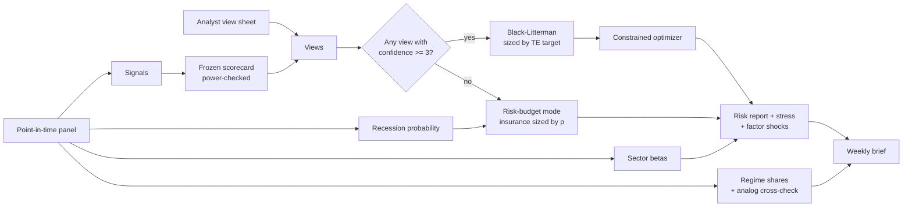

# Design note: quantamental engine

## The question it answers

What should the 11 sector weights be inside a tracking-error budget, given tested signals and the
analysts' views, and what happens when the evidence is weak?

## Data flow

## Interfaces

Every model: `run(panel, as_of, cfg)`. Only `panel.as_of`, `panel.returns_through` and
`panel.benchmark` may be used. Weights are a `pd.Series` indexed by sector key, summing to 1.

| Module | Consumes | Produces |
| --- | --- | --- |
| data.panel | config registry, caches | `Panel` |
| regime.* | Panel | regime shares, analog months, conditional returns |
| probability.* | Panel, regime shares | p(recession), scenario priors |
| sensitivities.betas | Panel | sector x factor betas |
| signals.* | Panel | scores per signal; scorecard (frozen by `make research`) |
| portfolio.views | view sheet, scores, scorecard | views table |
| portfolio.mode | views | `black_litterman` or `risk_budget` |
| portfolio.* | views, cov, benchmark | weights, attribution |
| risk.* | weights, Panel, betas | TE, contributions, VaR, replays, factor shocks |
| report.brief | everything above | HTML |

## The null-result rule

If no view reaches confidence 3, the engine runs the forecast-light risk-budget mode and says so
at the top of the brief. Weak evidence becomes a position (benchmark plus insurance), not silence.
